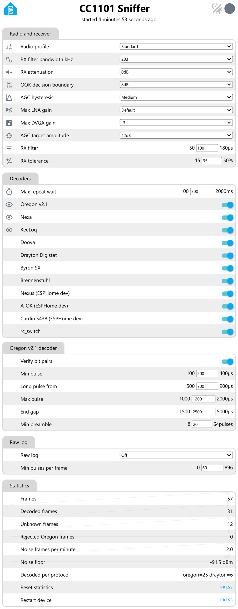

# esphome-cc1101-tools

ESPHome CC1101 tools for tuning the receiver and decoder settings, dumping raw signals and printing decoded protocol data. It helps you find the settings and decoder that work for your devices, so you can use them in your own ESPHome configuration.

## Summary

`esphome-cc1101-tools` lets you adjust and optimize the CC1101 receiver settings and view decoded data from ESPHome's RF decoders and a built-in Oregon v2.1 decoder.

The tools run as ESPHome firmware on a standard ESP32 board connected to a CC1101 module. All settings and measurements are accessible directly through ESPHome's built-in web server.

Once you've optimized the receiver settings, identified the appropriate decoder, and determined which values you want to capture, you can use these settings in your own dedicated ESPHome configuration with the desired sensor entities in Home Assistant.

Everything is built and installed using the standard ESPHome Device Builder in Home Assistant. It's purely a live diagnostic and tuning tool, so it doesn't send any data to Home Assistant. If you want to save data for later analysis, simply capture the log output to a file.

The hardware guides cover wiring, installation and tips, and link to a ready-to-use configuration example for each board: [WT32-ETH01](docs/hardware-wt32-eth01.md) and [ESP32 with Wi-Fi](docs/hardware-esp32-wifi.md).

## Defaults and radio profiles

All settings start at tested defaults, so your first install should work without any tuning. Instead of tweaking single values, you can pick a radio profile that sets five radio values in one go.

| Profile | Use when | Bandwidth | OOK decision boundary | Max DVGA gain | RX filter | RX tolerance |
| --- | --- | --- | --- | --- | --- | --- |
| Standard | Normal reception, the default | 203 kHz | 8 dB | -3 | 100 µs | 35 % |
| Sensitive | Senders are weak or far away | 203 kHz | 4 dB | -2 | 80 µs | 40 % |
| Noise hunting | Many false or broken frames | 162 kHz | 12 dB | -3 | 150 µs | 30 % |
| Custom | Your own values |  |  |  |  |  |

If you change a single value, the profile switches to Custom, or to whichever profile matches the new values.

## Web UI

The web UI at `http://<device name>.local/` groups the settings as shown below. Changes take effect right away and are kept after a restart, except Raw log. Every value is explained in detail in the [Reference Guide](docs/reference-guide.md); just click a name in the tables.



### Radio and receiver

| Field | Default | Purpose |
| --- | --- | --- |
| [Radio profile](docs/reference-guide.md#radio-profile) | Standard | Sets the five profile values at once |
| [Max DVGA gain](docs/reference-guide.md#max-dvga-gain) | -3 | Caps the second amplifier stage; lower gives less noise |
| [OOK decision boundary](docs/reference-guide.md#ook-decision-boundary) | 8 dB | Level step that counts as on; lower is more sensitive |
| [RX filter bandwidth kHz](docs/reference-guide.md#rx-filter-bandwidth-khz) | 203 kHz | Receiver bandwidth; narrower gives less noise but needs an exact frequency |
| [RX filter](docs/reference-guide.md#rx-filter) | 100 µs | Pulses shorter than this are merged as noise |
| [RX tolerance](docs/reference-guide.md#rx-tolerance) | 35 % | Timing margin for the ESPHome decoders |
| [RX attenuation](docs/reference-guide.md#rx-attenuation) | 0 dB | Lowers the input for very strong nearby senders |
| [Max LNA gain](docs/reference-guide.md#max-lna-gain) | Default | Caps the first amplifier stage |
| [AGC target amplitude](docs/reference-guide.md#agc-target-amplitude) | 42 dB | Signal level the gain control aims for |
| [AGC hysteresis](docs/reference-guide.md#agc-hysteresis) | Medium | How fast the gain control reacts |

### Decoders

| Field | Default | Purpose |
| --- | --- | --- |
| [Max repeat wait](docs/reference-guide.md#max-repeat-wait) | 500 ms | Copies of the same message that arrive within this time after the previous one count as one transmission |
| [Oregon v2.1](docs/reference-guide.md#decoder-switches) | On | Oregon Scientific v2.1 sensors |
| [Nexa](docs/reference-guide.md#decoder-switches) | On | Nexa RF codes |
| [KeeLoq](docs/reference-guide.md#decoder-switches) | On | KeeLoq (HCS301) RF codes |
| [Dooya](docs/reference-guide.md#decoder-switches) | On | Dooya RF codes |
| [Drayton Digistat](docs/reference-guide.md#decoder-switches) | On | Drayton Digistat RF codes |
| [Byron SX](docs/reference-guide.md#decoder-switches) | On | Byron SX doorbell RF codes |
| [Brennenstuhl](docs/reference-guide.md#decoder-switches) | On | Brennenstuhl RF codes |
| [Nexus (ESPHome dev)](docs/reference-guide.md#decoder-switches) | On | Nexus temperature and humidity sensor RF codes |
| [A-OK (ESPHome dev)](docs/reference-guide.md#decoder-switches) | On | A-OK RF codes |
| [Cardin S438 (ESPHome dev)](docs/reference-guide.md#decoder-switches) | On | Cardin S438 RF codes |
| [rc\_switch](docs/reference-guide.md#decoder-switches) | On | RCSwitch RF codes, used by many simple fixed-code remotes |

The descriptions follow the ESPHome documentation. Each switch shows or hides that decoder's lines. A hidden decoder still claims its frames, so they count under Decoded frames and won't show up as unknown. Drayton and rc\_switch are the exception: they have no checksum, so they only run when shown and need two identical copies. The ESPHome dev decoders are only compiled in when you build with ESPHome dev.

### Oregon v2.1 decoder

| Field | Default | Purpose |
| --- | --- | --- |
| [Verify bit pairs](docs/reference-guide.md#verify-bit-pairs) | On | Rejects messages where a bit and its complement disagree |
| [Min pulse](docs/reference-guide.md#min-pulse) | 200 µs | Shorter pulses are noise |
| [Long pulse from](docs/reference-guide.md#long-pulse-from) | 700 µs | Boundary between short and long pulses |
| [Max pulse](docs/reference-guide.md#max-pulse) | 1200 µs | Longer pulses are noise |
| [End gap](docs/reference-guide.md#end-gap) | 2500 µs | A gap this long ends a message |
| [Min preamble](docs/reference-guide.md#min-preamble) | 20 pulses | Long pulses needed before a message starts |

### Raw log

| Field | Default | Purpose |
| --- | --- | --- |
| [Raw log](docs/reference-guide.md#raw-log-1) | Off | Off, Unknown only or All; always Off after a restart |
| [Min pulses per frame](docs/reference-guide.md#min-pulses-per-frame) | 60 | Shorter frames count as noise and are not dumped |

### Statistics

The statistics update every 60 s. More about them under [Statistics](docs/reference-guide.md#statistics) in the Reference Guide.

| Field | Purpose |
| --- | --- |
| Frames | Captures received since boot or the last reset |
| Decoded frames | Captures a decoder accepted |
| Unknown frames | Captures of at least Min pulses that no decoder accepted |
| Rejected Oregon frames | Oregon messages that failed their checks |
| Noise frames per minute | Captures shorter than Min pulses, per minute |
| Noise floor | Median RSSI while nothing is received, in dBm; the base for snr\_db |
| Decoded per protocol | Accepted captures per decoder |
| Reset statistics | Zeroes the counters |
| Restart device | Restarts the ESP32 |

## Log format

Decoded, unknown and raw lines are logged at DEBUG, clock messages at INFO and WARNING. Every line starts with the time the transmission began, taken from SNTP (you'll see `up <seconds>` until the clock is synchronised).

```
<time> - <decoder> <decoded fields> signal_grade=<1..5> (snr_db=<dB>, rssi_dbm=<dBm>) rep=<copies> span_ms=<ms> max_gap_ms=<ms>
<time> - oregon rejected reason=<reason> nibbles=<hex> short_us=<µs> long_us=<µs> pair_errors=<n> signal_grade=<1..5> (snr_db=<dB>, rssi_dbm=<dBm>) rep=<copies>
<time> - oregon unknown type=<hex> channel=<n> unit_id=<hex> flags=<hex> checksum_nibbles=<n> nibbles=<hex> [guessed_temp=<°C>] [guessed_hum=<%>] short_us=<µs> long_us=<µs> pair_errors=<n> signal_grade=<1..5> (snr_db=<dB>, rssi_dbm=<dBm>) rep=<copies>
<time> - unknown pulses=<n> duration_ms=<ms> truncated=<yes|no> signal_grade=<1..5> (snr_db=<dB>, rssi_dbm=<dBm>)
<time> - raw pulses=<n> gap_ms=<ms> truncated=<yes|no> signal_grade=<1..5> (snr_db=<dB>, rssi_dbm=<dBm>)
  <pulse widths in µs, 32 per line>
```

An `oregon unknown` line means an Oregon sensor of a type the decoder doesn't know, but whose checksum it can still find. `rep` is the number of identical copies, and `span_ms` and `max_gap_ms` are the time from the first to the last copy and the largest gap between two. Raw frames use the tag `rf_raw`. Every field is explained under [Log fields](docs/reference-guide.md#log-fields) in the Reference Guide.

## Signal

Signal grade tells you how clearly a device is heard, from 5 (very clear) to 1 (barely). It's handy for finding the best spot for the receiver, and for spotting devices that are too far away to rely on.

| Reception | signal\_grade | snr\_db | rssi\_dbm at a noise floor of -83 dBm |
| --- | --- | --- | --- |
| Excellent | 5 | 25 dB or more | -58 dBm or stronger |
| Good | 4 | 18 to 24 dB | -65 to -59 dBm |
| Fair | 3 | 12 to 17 dB | -71 to -66 dBm |
| Weak, occasional losses | 2 | 6 to 11 dB | -77 to -72 dBm |
| At noise level, frequent losses | 1 | below 6 dB | weaker than -77 dBm |

The three values describe the same signal in three ways: as raw strength, as margin over the noise, and as a simple grade. `rssi_dbm` is the signal strength, the strongest reading during the transmission. `snr_db` is how much stronger that is than the background noise, and `signal_grade` is based on it. The dBm limits therefore move with the measured noise floor; -83 dBm is just an example. Right after start you'll only see `rssi_dbm`, until the noise floor is known. See [Radio signal levels](docs/reference-guide.md#radio-signal-levels) in the Reference Guide.

## Values set at compile time

These values can't be changed in the web UI, because they're built into the firmware. Change them in the YAML and install the firmware again. Most of them describe your hardware, so you'll rarely need to touch them. See [Values that can only be set at compile time](docs/reference-guide.md#values-that-can-only-be-set-at-compile-time) in the Reference Guide.

| Value | Default | Purpose |
| --- | --- | --- |
| [`name`, `friendly_name`](docs/reference-guide.md#name-friendly_name) | cc1101-sniffer | Device name in ESPHome and on the network |
| [`board`](docs/reference-guide.md#board) | wt32-eth01 | ESP32 board type |
| [`frequency`](docs/reference-guide.md#frequency) | 433.92 MHz | Receive frequency |
| Pins ([`spi_*`, `cc1101_cs_pin`](docs/reference-guide.md#spi-pins), [`rx_pin`](docs/reference-guide.md#rx_pin)) | see the hardware guides | Wiring to the CC1101 |
| [`activity_pin`](docs/reference-guide.md#activity_pin) | same as `rx_pin` | Data pin watched to time the RSSI reads |
| [`rx_symbols`](docs/reference-guide.md#rx_symbols) | 448 | Receive buffer; the longest frame is about 896 pulses |
| [`idle`](docs/reference-guide.md#idle) | 5 ms | Silence that ends a frame |
| [`filter_symbols`](docs/reference-guide.md#filter_symbols) | 20 | Frames shorter than this are dropped by the receiver |
| [`symbol_rate`](docs/reference-guide.md#symbol_rate) | 5000 | CC1101 data rate setting |
| [`logger` `level`](docs/reference-guide.md#logger-level) | DEBUG | Needed to see the decoded lines |
| [`timezone`](docs/reference-guide.md#timezone) | Europe/London | Local time for the log |
| [`update_interval`](docs/reference-guide.md#update_interval) | 60 s | Statistics interval |

## Limitations

- One frequency per build, receive only. The CC1101 listens on one frequency at a time, and these tools only listen.
- Frames longer than about 896 pulses are cut and marked `truncated=yes`. The ESP32 has 512 receive and transmit symbols in total, and 64 are kept free for a transmitter.
- RSSI is read at most four times per frame and only while the data pin is high. Every RSSI reading disturbs the received signal for a moment, so it is read rarely and only where the disturbance is hidden.
- If two devices send at the same time, both are lost. Their signals overlap and can't be told apart.
- With Wi-Fi, `power_save_mode: none` is required. In power save mode the ESP32 can report false signal changes on the data pin.
- Made for a trusted local network: the web UI has no login, OTA updates have no password and the API is not encrypted. Add `auth` under `web_server`, a `password` under `ota` or `encryption` under `api` if you need them.

## Quick start

1. Wire the CC1101 as shown in the hardware guide for your board: [WT32-ETH01](docs/hardware-wt32-eth01.md) or [ESP32 with Wi-Fi](docs/hardware-esp32-wifi.md).
2. In ESPHome Device Builder in Home Assistant, create a new device, replace its YAML with the configuration from the hardware guide and install it. The Wi-Fi configuration needs `wifi_ssid` and `wifi_password` in your ESPHome secrets.
3. Open `http://<device name>.local/` to change the CC1101 settings and watch the log in real time.

Requires ESPHome 2026.10.0 or later.

## Hardware

Tested on a WT32-ETH01 (Ethernet) and on an ESP32 NodeMCU, though any board with the classic ESP32 chip should work. Wiring, installation and tips for each board are in the hardware guides: [WT32-ETH01](docs/hardware-wt32-eth01.md) and [ESP32 with Wi-Fi](docs/hardware-esp32-wifi.md). `cc1101-sniffer.yaml` in the root is the shared base that both board configurations are checked against.

## License and status

MIT, see `LICENSE`. Credits and notices for third-party code are in `THIRD_PARTY_NOTICES.md`. Version 1.2.0: receiver tuning, decoders, raw dump, signal grade and radio profiles are available.
